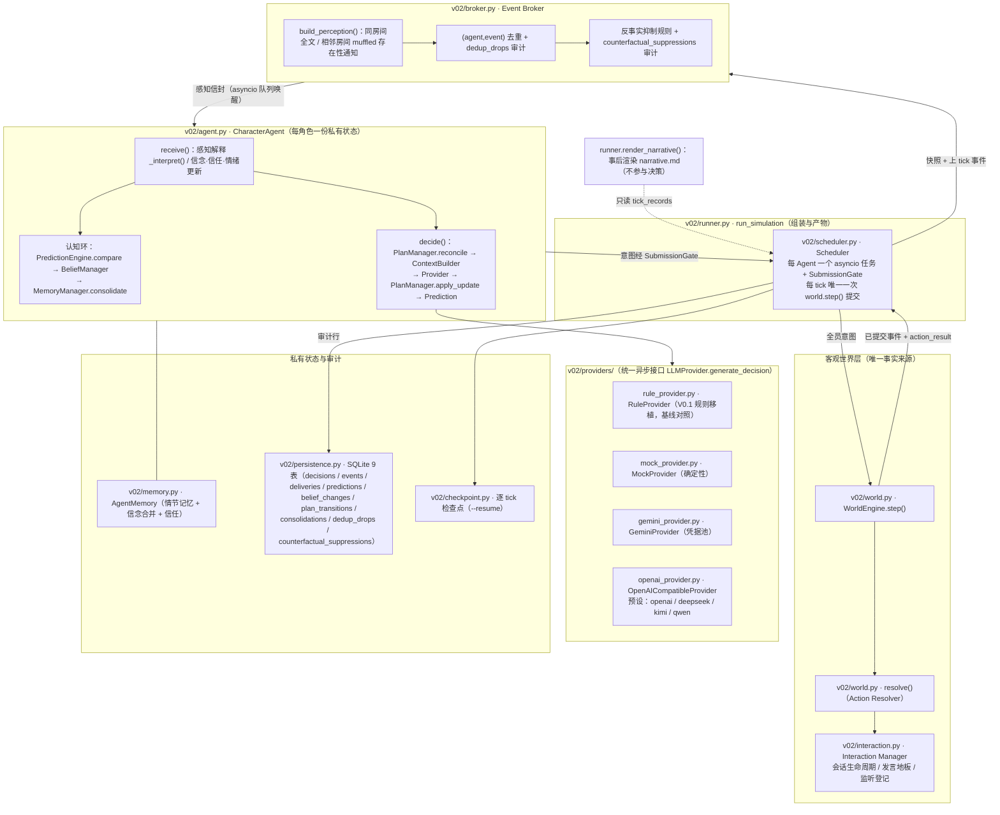

# EventsFlow V0.2-A · Phase 1 现有架构审查报告

日期：2026-11-11　阶段：Phase 1（只审查、不改代码）
审查对象：`~/workspace/multi-agent-story-sim/`（GitHub: lovsld/EventsFlow）

---

## 0. 审查说明（口径先行）

**任务书与仓库实际状态的根本差异**：V0.2-A 任务书假设仓库处于 V0.1
（文件为 `src/agent_brain.py`、`src/orchestrator.py`，决策规则写在
Agent Brain 里、LLM Provider 只是插槽）。实际仓库是**双栈并存**：

- `src/` + `characters/` + `tests/`：V0.1 多进程文件队列系统，**原样保留**
作对照基线，本次实测仍可运行（tests 10/10）。
- `v02/` + `characters_v02/` + `tests_v02/`：在 V0.1 之上已建成的 V0.2
系统——Pydantic Decision 协议、Rule/Mock/Gemini/OpenAI 兼容多后端
Provider、CharacterAgent + ContextBuilder、asyncio Scheduler +
SubmissionGate、Interaction Manager、Event Broker（(agent,event)
去重 + 反事实抑制）、预测处理认知环（Prediction / PredictionError /
BeliefManager / PlanManager / MemoryManager）、结果驱动计划步进、
实验 CLI（种子组 / 反事实）、动机-行为一致性审计（M1–M6）、检查点
与 `--resume`、`--loop` 额度暂停、多后端 Key 池。

因此本审查的判定对象是 **v02 系统**（V0.1 只作基线回归对象）。
任务书的文件名/目录假设与实际的逐项对照见第 8 节；一切判定**以代码
为准**，证据给出文件 + 类/函数定位。

**实测基线（2026-11-11 本次复跑）**：

| 套件 | 结果 |
|---|---|
| tests_v02/（87 个） | **87/87 通过** |
| tests/（V0.1 基线，10 个） | **10/10 通过** |
| 合计 | **97/97** |

**总判断**：任务书第三节的 14 条改造约束**全部已经在位**（World
Engine / Broker / Resolver / Perception / Memory 均保留、Rule 基线
保留、LLM 只提意图、Resolver 唯一入口、私有信息隔离、无 Key 可跑
rule）。V0.2-A 的真实差距不在"架构护栏"，而集中在**状态模型的深度**
三处：**信念没有证据结构、Goal 系统基本不存在、情绪只有两维在
运转**；外加一项实验空白（通用性实验 3 从未做过）和若干校验/配置
小缺口。按任务书第 16 节 16 条验收口径逐条判定：**满足 11 条、
部分满足 2 条、未满足 3 条**（明细见第 6 节）。

---

## 1. 当前架构图（基于实际代码）



要点：

- **唯一提交点**：`Scheduler.run()` 内每 tick 全员意图到齐后调用一次
`world.step()`（scheduler.py · `Scheduler.run`）；Agent 不持有 world
引用，意图只能经 `SubmissionGate.submit()` 进入（窗口外/未知
Agent/重复提交全部抛错，有契约测试）。
- **叙事不在决策环内**：`runner.render_narrative()` 在运行结束后从
tick_records 渲染 narrative.md，是只读事后产物。
- **审计旁路**：Agent 产生的认知链记录（预测误差、信念变化、计划
迁移、记忆巩固）经"chain updates"缓冲由 Scheduler 落库，Agent
本身不碰 DB（agent.py 文件头注释与 `drain_chain_updates` 实现）。

---

## 2. 当前 Agent 决策调用链（文件: 函数级）

### 2.1 Tick 主链

```
main.py · main() CLI: --mode/--ticks/--seed/--run-name/--resume/--provider/--loop
└─ v02/runner.py · run_simulation() 组装 World/Broker/Scheduler/Agents/Store；写 run_meta.json
└─ v02/scheduler.py · Scheduler.run(ticks) 每 tick 循环：
├─ world.snapshot() 客观状态深拷贝
├─ broker.publish(snapshot, last_events) v02/broker.py · EventBroker.publish
│ └─ build_perception()（broker.py:37） 逐 Agent 算感知 → _suppress()（反事实）→ _dedup()（去重）
├─ store.record_deliveries / _flush_dedup_drops / _flush_counterfactual_suppressions
├─ gate.open_window(); broker.dispatch_all(results) 感知信封入各 Agent 队列
├─ _agent_loop() → 见 2.2
├─ gate.wait_all() → close_and_collect()
├─ world.step(intents) v02/world.py · WorldEngine.step —— 唯一提交点
│ └─ resolve()（world.py:43） initiative 排序 → 逐意图校验/执行 → Interaction Manager 同步会话
├─ store.record_decision（+ record_prediction / record_plan_transition 同键）
├─ store.record_events(events)
└─ on_tick_end 快照（Phase D 实验钩子）/ on_tick_committed 检查点（checkpoint.py）
└─ 终局感知轮：publish + dispatch_all(final=True)，Agent 只解释不决策
```

### 2.2 Agent 认知链（单个 Agent 任务内）

```
scheduler · _agent_loop()
├─ agent.receive(perception, action_result) v02/agent.py:178
│ ├─ _evaluate_pending(perception, action_result) agent.py · _evaluate_pending
│ │ ├─ PredictionEngine.compare(pred, result, perception) v02/prediction.py（纯函数，不改状态）
│ │ ├─ BeliefManager.apply_prediction_error(agent, pred, error) v02/belief_manager.py:35（规则表改信任/信念/怀疑）
│ │ ├─ MemoryManager.consolidate(agent, pred, error, tick) v02/memory_manager.py（重要性评分 → 长期记忆晋升）
│ │ └─ _advance_step_from_result(...) agent.py · 结果驱动步进：
│ │ plan_steps.step_fulfilled()（v02/plan_steps.py）→ PlanManager.advance_from_result()（plan_manager.py）
│ ├─ action_result.found 含 anonymous_letter → 硬编码分支：写亲历记忆/信念、_set_plan（见第 5 节问题 P-3）
│ ├─ for ev in perception.events: _perceive_event(ev, tick) agent.py:223（记忆分账、utterances_heard、pending_question）
│ │ └─ 言语事件 → _interpret(ev) agent.py:253（claim 分支表 → 信念/情绪/信任/计划，见 P-3）
│ ├─ muffled → suspicion +0.05 + inferred 记忆
│ └─ memory.save_state()（state.json / beliefs.md）
├─ scheduler._persist_chain_updates(agent) chain updates → Store 四类记录落库
└─ agent.decide(perception) agent.py:340（经 _decide_with_quota_retry 包裹 --loop 额度重试）
├─ PlanManager.reconcile(state, tick) plan_manager.py · 承诺衰减（0.02/tick，下限 0.1）
├─ context_builder.build_context(agent, perception) v02/context_builder.py:19（只读本人状态 + 本次感知）
├─ provider.generate_decision(context) v02/providers/base.py:33 统一异步接口
│ ├─ RuleProvider.generate_decision rule_provider.py:96（候选生成 + 效用评分 + argmax）
│ ├─ GeminiProvider / OpenAICompatibleProvider 提示构建 → sanitize → Pydantic 校验 → 有限修复重试
│ └─ MockProvider 确定性桩
├─ PlanManager.apply_update(state, decision.plan_update) plan_manager.py · abandon/replace 无理由拒绝并记录
├─ PredictionEngine.predict(agent, context, decision) v02/prediction.py（5 个可核对字段 + basis 快照）
└─ 返回 (decision, audit record) → gate.submit(intent_from_decision(decision))
※ ProviderError → decision=None → intent = {"verb": "wait"}（降级，不崩）
```

### 2.3 与任务书第六节"统一决策流程"的对照

任务书流程：Perception → Memory Update → Belief Update → Emotion
Update → Goal Evaluation → Plan Evaluation → 候选生成 → 效用评估 →
选择 → Intent JSON → Intent Validation → Action Resolver。

实际链路中：Perception / Memory / Belief / Emotion 更新都存在（在
receive 与 _evaluate_pending 中，顺序为"先评估上一决策的预测误差，
再解释新感知"）；Plan Evaluation 存在（reconcile + apply_update +
结果驱动步进）；**Goal Evaluation 不存在**（目标是静态配置，decide
从不评估目标，见第 4 节）；**候选生成与效用评估只存在于 Rule
Provider 内部**（LLM 路径由模型在 available_actions 内直选，无程序
侧效用层）；**Intent Validation 不是独立组件**，由三段拼凑：
Provider 内 sanitize + Pydantic 校验、Resolver 的合法性校验、审计
工具的事后 M4c 检查（详见第 5 节 P-5）。

---

## 3. 当前 Agent 状态数据结构（实际载体）

运行时状态集中在 `v02/protocol.py · CharacterState`（protocol.py:60），
每 Agent 一份私有实例；配置与状态分离（config.py ·
CharacterConfig ← characters_v02/<id>/ 四个 YAML）。

| 任务书概念 | 实际载体 | 实际字段 | 与任务书模型的差距 |
|---|---|---|---|
| Identity | `CharacterConfig`（config.py）+ `CharacterState.personality / principles` | profile.yaml：character_id / legacy_id / name / role / identity（背景文本）/ start_location / possessions / seed_offset / disclosure_threshold / private_knowledge（初始信念）；personality.yaml：caution / curiosity / honesty / impulsiveness / sociability（0–1 浮点）；principles.yaml：行为原则字符串列表 | 结构基本对应。behavioral_principles 以 constraints 形式进决策上下文 ✓。人格在 rule 路径是效用权重 ✓；在 LLM 路径只是系统提示里的原始数字。人格维 `honesty` 在 v02 代码中**从未被任何逻辑读取**（只随 personality dict 整体进 LLM 提示） |
| Goals | `protocol.Goal`（protocol.py:36）于 `CharacterState.goals`，来自 goals.yaml | 仅 `key / desc / weight` 三字段 | **无 goal_id 语义之外的结构**：无 status / progress / commitment / created_at / deadline；运行时**从不被修改**（全仓无对 state.goals 的写操作）；无目标变化历史；决策协议无 selected_goal_id。实质是"静态目标清单 + 权重"，不是任务书的目标系统 |
| Beliefs | `protocol.Belief`（protocol.py:29）于 `CharacterState.beliefs`，经 `AgentMemory`（memory.py）读写 | `key / confidence(0–1) / kind ∈ {experienced, heard, inferred} / desc` | **无 evidence 列表**：无 source_event_id / reliability / observed_at；kind 是**单一标签**且合并时不升级（核心问题 P-1）；source_type 只有 3 类，与任务书 5 类（direct_observation / direct_interaction / testimony / inference / assumption）不对应（experienced 合并了观察与互动，assumption 无对应） |
| Emotions | `CharacterState.emotions: dict[str, float]`（protocol.py 默认值） | 默认 `{arousal: 0.3, valence: 0.0, suspicion: 0.3}` | **无统一 EmotionState 模型**。实际只有 suspicion（16 处写）与 arousal（6 处写）两维在运转；valence 是**死字段**（全仓无读写逻辑）；任务书六维 fear/anger/curiosity/trust/confidence/stress 均不存在——trust 在 relationships 里、curiosity 是人格维。值域靠各写点的 min/max 手工钳制 |
| Plans | `protocol.PlanState`（protocol.py:42）于 `CharacterState.current_plan`（**单数**），由 `PlanManager`（plan_manager.py）管理 | plan_id / goal（字符串）/ steps: list[str] / current_step / commitment / status ∈ {active, completed, abandoned} / interruption_conditions / interrupt_log / step_history / last_progress_tick / commitment_updated_tick | 跨 Tick 持续 ✓、步进双通道（结果驱动 + provider 显式）✓、承诺衰减/加分 ✓、迁移全量落 plan_transitions ✓。差距：**同时只能有一个活跃计划**（新计划替换旧计划）；status 无 blocked / cancelled；steps 是自由字符串（谓词表外的步名不可判定，见 P-6）；interruption_conditions **从未被求值**（只存不用）；无 created_at（只有 tick 计数器字段近似） |
| Memory | `CharacterState.short_term_memory / long_term_memory` + `AgentMemory`（memory.py） | STM 条目 {tick, kind ∈ experienced/heard/inferred, text, event_id}；LTM 由 MemoryManager 按 importance = 类型基分 + 0.5×surprise、阈值 0.65 晋升（memory_manager.py）；另有 utterances_heard、perceived_event_ids、relationships{trust, notes}、action_counts、pending_question | 三类记忆分账 ✓、巩固评分与预测误差挂钩 ✓、落盘 state.json/memory.md/beliefs.md ✓。小缺：`memory_summary` 字段已声明但**从未被写入**（死字段）；relationships.notes 从未被写 |
| Relationships | `CharacterState.relationships: dict[str, {trust, notes}]` | trust 0–1，初始 0.3；经 adjust_trust 修改（感知事件 + 预测误差两路） | 信任变化入 belief_changes 表（kind=trust）✓ |
| 决策协议 | `protocol.AgentDecision`（protocol.py:100） | intent（自由文本串）/ target / action: ActionSpec{type, target, target_location, object, content, claim, topic} / reasoning_summary / expected_outcome / confidence(0–1) / plan_update{status ∈ none/continue/advance/abandon/replace, reason, new_goal, new_steps} | 与任务书第八节对照见第 5 节映射表；主要差：无 selected_goal_id、未知字段默认 ignore 而非 forbid |

**持久层**（persistence.py，SQLite，DATABASE_URL 可切换）：9 张表——
agent_decisions（含 context_json 全量快照、parsed_output、
execution_result、error、latency、token）、world_events、
event_deliveries、dedup_drops、counterfactual_suppressions、
predictions（预测 + 误差 + surprise）、belief_changes、
plan_transitions、memory_consolidations。`Store.chain_for()` 可仅凭
DB 重建任一决策的完整链。**注意覆盖面**：belief_changes 只记录
**预测误差路径**的信念/信任变化；感知解释路径（_interpret）的信念
变化不入此表，只能从事后 context 快照 diff 重建（见 P-2）。

---

## 4. 模块清单：保留 / 已抽象 / 待处理

### 4.1 保留模块（满足任务书第三节约束，不动）

| 模块 | 文件 | 保留依据 |
|---|---|---|
| World Engine | v02/world.py · WorldEngine | V0.1 规则忠实移植，唯一客观状态持有者 |
| Action Resolver | v02/world.py · resolve()（world.py:43） | 唯一行动执行入口，校验规则未动 |
| Event Broker | v02/broker.py | 唯一"已提交事件 → Agent"通道，去重/抑制均带审计 |
| Perception | v02/broker.py · build_perception()（broker.py:37） | 同房间全文 / 相邻 muffled / 其余无，V0.1 规则逐字 |
| Interaction Manager | v02/interaction.py | 会话生命周期、地板、监听登记，Resolver 经它判定 |
| Memory（情节/信念载体） | v02/memory.py · AgentMemory | V0.1 三类分账语义的移植（合并规则问题见 P-1，属修复非替换） |
| RuleBasedProvider | v02/providers/rule_provider.py | V0.1 决策逻辑移植，基线对照组（剧情耦合是其定位，见 P-4 说明） |
| 角色 Profile 格式 | characters_v02/<id>/{profile,personality,principles,goals}.yaml | 由 V0.1 profile 逐字迁移的数据驱动格式 |
| Scheduler + SubmissionGate | v02/scheduler.py | 事件驱动 + 每 tick 单次提交，确定性已验证 |
| 审计与实验仪器 | v02/persistence.py、v02/audit.py、v02/experiments.py、experiments.py / audit.py CLI | 9 表审计链、M1–M6 指标、种子组/反事实运行器 |

### 4.2 已经抽象到位的模块（任务书要求、现状已成立，不再列入改造）

- **DecisionProvider 统一接口**：`providers/base.py · LLMProvider.generate_decision(context)`（异步），
Rule/Mock/Gemini/OpenAI 兼容四后端共 6 个实现同接口；有
"同 Agent 同 Context 换 Provider"测试（test_phase_a.py:174）。
- **认知环四组件**：prediction.py / belief_manager.py /
plan_manager.py / memory_manager.py 均为独立可测组件，落库可还原全链。
- **Provider 配置面**：后端选择、Key 池、模型覆盖、节奏、额度语义
全部经环境变量/CLI（清单见第 5 节映射 §七）。
- **检查点/续跑/额度暂停**：checkpoint.py + `--resume` + `--loop`
（任务书未要求，属已有增量能力，改造时不得回退）。

### 4.3 需要修复/补齐的问题清单（每条带定位）

**P-1（核心）**
`v02/memory.py:68 · AgentMemory.update_belief`：同 kind 取 max；
异 kind 时 `confidence = 0.6*old + 0.4*new`，且 **kind 与 desc
永不更新**。后果（可直接构造）：先听到传闻 `anonymous_letter_exists
= 0.7/heard`，后被 show 亲眼看到信（`agent.py · _perceive_event`
show 分支以 1.0/experienced 调用 update_belief）→ 结果
0.82 / **仍是 heard**——任务书 §5.3 明确警告的"旧来源没有正确
升级"在代码中真实存在。反向同样成立：亲历 1.0 之后再听到 0.7
传闻 → 被拖到 0.88。另外：无按 event_id 的信念级去重（投递层
Broker 去重兜住了同一事件，但同一命题经不同事件重复到达会反复
blend 漂移）；多个相关传闻（如同一人多次 mayor_hint）没有
"同源不算独立证据"的处理。规范轨迹中士兵的信件信念最终是
1.0/experienced，只是因为他在形成 heard 版该信念之前就先搜到了
信——缺陷是**潜伏**的，换个事件顺序即触发。

**P-2**
`belief_changes` 表只由 `agent.py · _evaluate_pending` 的预测误差
路径写入；`_interpret` / `_perceive_event` / receive 找信分支造成
的信念变化（实际是信念变化的主要来源）不入表。审计时只能靠逐
决策 context 快照 diff 重建（STEP1 审计即如此做的）。

**P-3**
`v02/agent.py:253 · _interpret` 是按 claim 标签（mayor_hint /
letter_question / denial / bluff_hint …）与角色 id 分支的硬编码
表：为每个角色写死"听到这句话 → 形成什么信念、立什么计划、情绪
加多少"；receive() 开头找信分支（agent.py · receive 内
action_result.found 处理）同样写死信念值与计划步骤名。这层不在
Provider 里、与 Provider 无关——**LLM 模式运行时它照样执行**。
定性：V0.1 的"剧情 if/else"在 v02 中已从**决策层**清除（决策由
Provider 承担），但**保留在感知解释层**。它承担的是"言语行为的
语义"（一句话对听者意味着什么），并非全无道理；但按 V0.2-A
"不为每段剧情编写规则、换场景不改代码"的目标，这是当前离通用
化最远的一块，且没有任何数据化/可替换机制。

**P-4**
`rule_provider.py` 含大量角色/信件/镇长分支与固定台词表
（TOPIC_LINES）。这是任务书要求保留的 V0.1 基线对照组，其文档
字符串明示"V0.1 rules, unchanged in substance"，不伪装成通用
机制——符合任务书"不要把现有剧情规则伪装成通用决策机制"的
要求。通用性主张只由 LLM 路径承担。审查结论：**保留，不列入
修复**；但任何"系统已通用化"的表述必须注明该结论只对 LLM
路径 + 解释层之外成立（P-3 是例外）。

**P-5**
- Provider 内：`_sanitize`（枚举同义词强制转换、plan status
非法值**静默改为 none**、confidence 钳制）+ `AgentDecision`
Pydantic 校验。但 `AgentDecision / ActionSpec / PlanUpdate`
均未设 `extra="forbid"`（protocol.py:100 起）——未知字段被
静默 ignore，不报错（任务书校验第 8 条要求"不允许未知字段
绕过校验"：现状是字段被丢弃、无法绕过执行，但也不构成
严格拒绝）。
- 成员校验缺失：运行时**没有任何一处**校验 LLM 选出的行动
∈ 本次 context 的 available_actions（该检查只存在于审计
工具的事后 M4c，audit.py:426）。靠 Resolver 兜底合法性
（非法移动/不在场发言/未持有展示都会被拒），但"校验层"
与任务书分层不完全对应。
- 目标归属无从校验：协议无 selected_goal_id；
plan_update.new_goal 是自由字符串，不校验是否属于该角色
的目标集（任务书校验第 5 条）。

**P-6**
`plan_steps.py` 的 step_consistent 谓词表只覆盖 rule 场景的
约 14 个固定步名；未知步名返回 None（不可判定）。LLM 自创的
自由文本步名几乎必然落入 None → 结果驱动步进对 LLM 计划
不触发（实测：llm_full20_planlayer_seed42 的 5 次 advance
全部来自 provider 显式声明，0 次结果驱动）。另外 PlanState
的 interruption_conditions 从未被求值；解释层 _set_plan 替换
计划时不看 commitment（高承诺计划可被一条新 claim 直接整段
替换，"高承诺抗打断"没有门控实现，只有承诺衰减/加分记账）。

**P-7**
- 世界地图/物品写死在 `world.py · WorldEngine.__init__`：
5 个地点、房内物品、`anonymous_letter` 对象（holder/位置）
全部是代码常量；search 的"找到"逻辑（world.py resolve 的
search 分支）与 show 的对象判断都只认 anonymous_letter。
- ADJACENCY 邻接表有 **4 份副本**（world.py、broker.py、
context_builder.py、providers/rule_provider.py），一致性靠
人工同步（plan_steps.py 是从 context_builder 导入的，属
唯一一处收敛）。
- 角色名单写死：`config.py · ALL_IDS = ["owner","merchant",
"soldier"]`，新增角色必须改代码。
- context_builder 里 show 的可用性判断写死了
"owner + 信件亲历信念"这一场景条件（context_builder.py ·
build_context 内）。

**P-8**
- LLM 超时不可经环境变量配置：两家 Provider 的 timeout 是
构造参数（默认 60s），make_provider 从不传值，实际恒为
60s（任务书建议 EVENTSFLOW_LLM_TIMEOUT=30，实际无对应物）。
- `ACP_TEMPERATURE` 存在但任务书口径的其余配置映射见第 5 节。

**P-9**
`CharacterState.memory_summary` 从未写入；`relationships[*].notes`
从未写入；personality 的 `honesty` 从未被逻辑读取；
`PlanState.interruption_conditions` 只存不用（P-6）。均为小
问题，列出以免后续误以为它们在工作。

**P-10**
world.py:34 的 VERBS 含 give/take 共 13 个，与任务书基础动词
表一致；但：(1) `protocol.ActionType`（protocol.py:15）只有
11 个动词，**不含 give/take**——Provider 在协议层就发不出；
(2) Resolver 对 give/take 与 observe/work/wait 同分支处理
（world.py · resolve 末尾分支）：只发一个事件、ok=True，
**不转移任何物品、不校验目标**（世界状态里除信件外也没有
可转移的持有关系）。即 give/take 目前是占位动词。
negotiate / cooperate / hide / investigate 四个候选新动词
则在 VERBS、ActionType、available_actions 中**全部不存在**。

---

## 5. 任务书逐条映射表

判定图例：✅ 满足　◐ 部分满足　✗ 未满足

### §二 改造目标（通用决策系统）

| 要求 | 判定 | 证据 | 差距说明 |
|---|---|---|---|
| 开发者只定义人格/背景/目标/初始信念/资源/世界规则，角色自行决策 | ◐ | LLM 路径：config YAML + ContextBuilder + LLM Provider 已成立（characters_v02/、context_builder.py、providers/）；20-tick 真实 LLM 运行 60/60 决策完成（runs_v02/llm_full20_planlayer_seed42） | 解释层 _interpret（P-3）与世界层场景硬编码（P-7）仍是"为这段剧情写好的代码"；换场景时这两处必须改 |
| 不再需要针对每段剧情编写决策规则 | ◐ | 决策层已清除（Provider 化）；rule 基线的剧情规则是明示的对照组（P-4） | 解释层 P-3 是剩余的剧情规则所在 |

### §三 改造约束（14 条）

| # | 约束 | 判定 | 证据 |
|---|---|---|---|
| 1 | 保留 World Engine | ✅ | v02/world.py（V0.1 规则移植，PHASE_A/B 报告有逐字对照） |
| 2 | 保留 Event Broker | ✅ | v02/broker.py |
| 3 | 保留 Action Resolver | ✅ | v02/world.py · resolve() |
| 4 | 保留 Perception 和 Memory Manager | ✅ | broker.build_perception；v02/memory.py（注意：v02 另有同名 memory_manager.py，是巩固组件，见第 8 节对照） |
| 5 | 保留角色 Profile 格式/兼容层 | ✅ | characters_v02 YAML 四件套由 V0.1 profile 逐字迁移；V0.1 原文件未动 |
| 6 | 保留 RuleBasedProvider 作基线 | ✅ | providers/rule_provider.py |
| 7 | LLM 只提意图、不改世界 | ✅ | Provider 只收 DecisionContext、只回 AgentDecision；无 world 引用 |
| 8 | 行动必经 Action Resolver | ✅ | SubmissionGate + world.step 单次提交；test_submission_gate_contract |
| 9 | Agent 只用自有感知/记忆/信念决策 | ✅ | ContextBuilder 只读本人 state + 本次感知（context_builder.py） |
| 10 | 不读他人私人记忆 | ✅ | 每 Agent 独立 CharacterState 实例；隔离测试 test_information_isolation_memory_subset_of_deliveries（test_phase_a.py:234）；审计 M2/M2b 零违例 |
| 11 | 叙事模块不参与决策 | ✅ | render_narrative 为事后只读渲染（runner.py） |
| 12 | 不为精彩修改客观事实 | ✅ | 世界变化只经 Resolver 规则；环境事件是预置 AMBIENT 表按世界 RNG 触发，属世界规则 |
| 13 | 不硬编码 API Key | ✅ | 全部 Key 经环境变量/凭据池；有哨兵 Key 泄漏扫描测试（test_local_runtime.py、test_multibackend.py） |
| 14 | 无模型 API 时 rule 可正常运行 | ✅ | 默认路径 rule；llm 无 Key 时 preflight 报错退出码 2、不启动运行（test_llm_preflight_requires_key） |

**小计：14/14 满足。**

### §四 目标架构分层

| 层 | 判定 | 现状 |
|---|---|---|
| AgentBrain（组织内部状态与决策流程） | ✅ | CharacterAgent（agent.py），职责与任务书一致 |
| DecisionProvider 统一接口 | ✅ | providers/base.py 异步接口，6 实现 |
| RuleBasedProvider 独立 | ✅ | 已从 V0.1 的 Brain 中拆出为纯 context 函数（V0.1 里解释与决策同在 RuleBasedProvider 类内，见 src/agent_brain.py:65） |
| LLMProvider | ✅ | Gemini + OpenAI 兼容四后端 |
| Decision Intent | ✅ | AgentDecision（Pydantic） |
| Intent Validator（独立层） | ◐ | 无独立组件；sanitize+Pydantic（Provider 内）/ Resolver 合法性 / 审计事后检查三段拼凑，缺成员校验与严格字段（P-5） |
| Action Resolver | ✅ | world.resolve() |
| World Engine | ✅ | world.WorldEngine |
| Event Broker → Perception | ✅ | broker.publish/build_perception |
| LLM 不得直接调用 World Engine | ✅ | 结构上不可能（无引用、无路径） |

### §五.1 Identity

| 要求 | 判定 | 证据/差距 |
|---|---|---|
| 人格以决策偏好/效用参数存在，而非剧情规则 | ◐ | rule 路径 ✅（rule_provider 评分中 caution/sociability/curiosity/impulsiveness 均为数值权重）；LLM 路径 ◐（人格以原始数字进系统提示，无偏好语义转译，靠模型自行理解） |
| behavioral_principles 影响决策 | ◐ | 以 constraints 字符串进 context（LLM 可见）；rule 路径不读 principles（靠 disclosure_threshold 等数值门控近似，如 show 的披露门槛来自 config 数值字段） |
| 五个示例倾向（谨慎/冲动/好奇/社交/诚信） | ◐ | 前四者在 rule 效用中有对应项；**诚信 honesty 无任何逻辑对应**（P-9），rule 的 bluff 行为由 curiosity 门控而非 honesty |

### §五.2 Goals

| 要求 | 判定 | 证据/差距 |
|---|---|---|
| 结构化 Goal（id/desc/priority/status/progress/commitment/created_at/deadline） | ✗ | protocol.Goal 只有 key/desc/weight（protocol.py:36） |
| 多目标并存 | ◐ | 配置层多目标并存 ✅（每角色 3 个 Goal）；但决策从不"选择目标"，无目标级推进 |
| 优先级可随环境变化 | ✗ | weight 静态，运行时不变 |
| 目标不能每 Tick 随意改变；commitment 概念 | ✗ | Goal 无 commitment（commitment 只存在于 Plan） |
| 完成/失败/重大变化时重评估 | ✗ | 无 Goal 状态机，不存在重评估事件 |
| 目标变化历史 | ✗ | 无 goal 历史表/记录 |
| 目标驱动行为（实质） | ◐ | 间接成立：目标以文本进 LLM 提示；rule 路径的行为由硬编码分支实现"像在追求目标"；计划有 goal 字符串标签但不回指 Goal 对象 |

### §五.3 Beliefs（任务书重点，逐项核）

| 要求 | 判定 | 证据/差距 |
|---|---|---|
| 每信念保存 evidence 列表（source_event_id / source_type / reliability / observed_at） | ✗ | Belief 无 evidence 字段（protocol.py:29）；情节记忆条目有 event_id 与 tick，但不与信念关联成证据链 |
| source_type 五类区分 | ✗ | 只有 3 类 kind（experienced/heard/inferred）；direct_observation 与 direct_interaction 未分开；assumption 无对应 |
| 置信度由证据重算 | ✗ | 置信度是逐次合并的标量（memory.py:68 的 max / 0.6-0.4 blend），不从证据集重算 |
| 同一事件重复到达不重复累积 | ◐ | 投递层 ✅（Broker (agent,event) 去重 + dedup_drops 审计）；信念层 ✗（无 event 级去重，异 kind 重复到达会反复 blend 漂移；同 kind 靠 max 近似幂等） |
| 传闻→亲眼来源升级正确 | ✗ | **缺陷确认存在**（P-1）：kind 永不升级，亲历 1.0 与传闻 0.7 合并得 0.82 且仍标 heard |
| 低可靠传闻不阻止后来的直接证据 | ✗ | 同上：直接证据被 0.6 权重拖低 |
| 相关传闻不被当作多个独立证据叠加 | ◐ | 现状没有"叠加"机制（是单标量合并），故不会叠加成高置信；但代价是完全没有证据累积语义——多次独立佐证与一次传闻在数据上不可区分 |
| 信念变化历史 | ◐ | belief_changes 表存在但只覆盖预测误差路径（P-2）；解释路径变化靠 context 快照 diff（审计已验证可行但非一等记录） |
| 信念≠客观事实、不把 World 全状态写入信念 | ✅ | 信念只经感知解释与预测误差两路形成；M2 审计 24/24 断言型行动均有信念支撑、M2b 反向检查零违例 |

### §五.4 Emotions

| 要求 | 判定 | 证据/差距 |
|---|---|---|
| 统一 EmotionState（fear/anger/curiosity/trust/confidence/stress，0–1） | ✗ | 无该模型；实际 emotions dict 只有 suspicion/arousal 在运转、valence 死字段（第 3 节） |
| 情绪影响行动效用而非直接决定 | ◐ | rule 路径 ✅ 形态正确（suspicion 进 move/search 评分项，属加权影响）；LLM 路径 ◐（emotional_state 数字进 context，无显式效用通道，靠模型理解） |
| 情绪变化有事件/交互依据 | ✅ | 全部写点都在感知解释或预测误差路径中，无凭空变化；幅度可审计（belief_manager 规则表 + _interpret 定值） |
| 不引入复杂心理学模拟 | ✅ | 现状甚至过于简单（两维） |

### §五.5 Plans

| 要求 | 判定 | 证据/差距 |
|---|---|---|
| Plan 结构（id/goal/desc/steps/current_step/status/commitment/created/updated/interruption_policy） | ◐ | 大部分字段有对应（第 3 节表）；steps 是 list[str] 非 list[dict]；无独立 description（goal 串兼任）；created_at 只有 tick 近似字段；interruption_conditions 存在但从未求值（P-6） |
| 状态 active/blocked/completed/cancelled | ◐ | 有 active/completed/abandoned（abandoned ≈ cancelled 语义）；**无 blocked** |
| 多步骤、跨 Tick 持续 | ✅ | PlanManager + 计划层步进；种子组实测 83 次 advance、32 次计划完成（PLAN_LAYER_REPORT） |
| 步骤完成后进入下一步 | ✅ | 结果驱动 advance_from_result + provider 显式 advance，双通道有防双计（签名 dedup）与专门测试 |
| 失败后重试/调整/放弃 | ◐ | 放弃/替换有 reason 门控 ✅；失败本身不产生计划级状态变化（无 blocked、无重试计数）——失败的影响经预测误差→信任/信念间接传导（见 §十六第 11 条） |
| 重要新信息时可重新规划 | ✅ | 解释层 _set_plan + provider replace（带 reason）两路 |
| 计划有持续性、高承诺不被普通事件轻易打断 | ◐ | 承诺衰减是渐进记账（0.02/tick）✅；但**无承诺门控**：解释层替换计划不看 commitment（P-6），高承诺与低承诺计划被替换的难易相同 |
| 计划执行可测试可记录 | ✅ | plan_transitions 全量落盘（含 set/replace/advance/dedup/decay/complete/rejected，链修复后 M5 有据率 1.0） |

### §六 统一决策流程

| 步骤 | 判定 | 现状 |
|---|---|---|
| Perception / Memory Update / Belief Update / Emotion Update | ✅ | receive + _evaluate_pending（第 2.2 节链路） |
| Goal Evaluation | ✗ | 不存在（§五.2） |
| Plan Evaluation | ✅ | reconcile + apply_update + 结果驱动步进 |
| 候选行动生成（来自通用行动能力） | ◐ | LLM 路径 ✅（available_actions 通用生成，context_builder）；rule 路径 ✗ 通用性（剧情分支生成候选，属基线定位） |
| 行动效用评估（任务书公式八项） | ◐ | **不存在该公式的显式实现**。rule 路径有事实上的效用评分（基分 + 人格项 + 情绪项 + 重复惩罚 + 抖动 + 步对齐加分 0.35），因素与公式部分对应（Personality/Emotion/PlanConsistency 有，GoalAlignment 藏在分支基分里，InformationValue/ResourceCost/SocialCost 无独立项），未归一化；LLM 路径无程序效用层 |
| Action Selection | ✅ | rule = argmax（抖动 0.18 有界，不压倒一致性，另有重复惩罚）；LLM = 模型直选 + 校验 |
| Intent JSON → Validation → Resolver | ◐ | 见 P-5 |

**按任务书"结合当前代码选择更稳定的实现方式"的评估**：现状的
"LLM 在 available_actions 内直选 + 三段把关"已有真实运行证据
（20-tick 全量 LLM 运行 60/60、审计口径可复算），且任务书原文
允许"LLM 直接选择"这一形态，并明确警告"不要为了形式上的复杂
而实现没有实际作用的评分模块"。审查意见：**维持现状形态**，
不新造独立效用打分层；先补 P-5 的校验缺口（成员校验、严格
字段），若未来对 LLM 轨迹跑审计发现直选不合理（如 M1/M2
显著差于 rule），再以数据立项效用层。

### §七 DecisionProvider 接口与配置

| 要求 | 判定 | 证据/差距 |
|---|---|---|
| 统一 decide 接口、调用链一致 | ✅ | 异步 generate_decision(context)（base.py:33）；任务书允许同步或异步、要求一致——现状一致 |
| Rule 从 AgentBrain 独立 | ✅ | rule_provider.py 是纯 context 函数；解释层归 Runtime（这点比 V0.1 更干净：V0.1 的 _interpret 在 RuleBasedProvider 类内） |
| 保留 seed 实验能力 | ✅ | Provider 自带 seeded RNG（seed + config.seed_offset）；种子组/反事实 CLI |
| LLM 可配置（服务/模型/温度/超时/重试） | ◐ | 模型/温度/后端/base_url 均可配；**超时不可经 env 配**（P-8）；重试有界（修复重试 ≤3、Key 轮换、指数退避） |
| JSON 输出、错误日志、不崩 | ✅ | 决策失败 → ProviderError → wait 降级 + error 落 agent_decisions（scheduler/agent 的 record 路径） |
| 无 Key 默认 rule | ✅ | 见约束 14 |

**配置面映射（任务书建议名 → 实际名）**。任务书明言"已有配置
机制优先沿用"，实际体系是 ACP_* + CLI，已全面落地于代码、
测试与 LOCAL_DEPLOY.md，建议**不改名**（理由见第 9 节）：

| 任务书建议 | 实际对应 |
|---|---|
| EVENTSFLOW_PROVIDER=rule | `--mode rule｜llm｜mock`（CLI）；llm 后端 `--provider` / `ACP_PROVIDER`（旧别名 `ACP_LLM_PROVIDER` 仍 honored） |
| EVENTSFLOW_LLM_API_KEY | 按后端分开：`GEMINI_API_KEY` / `ACP_GEMINI_KEYS`（原始池）/ `ACP_GEMINI_CREDENTIALS`（凭据名池）；`ACP_DEEPSEEK_KEYS` / `ACP_KIMI_KEYS` / `ACP_QWEN_KEYS` / `ACP_OPENAI_KEYS`（池）与 `DEEPSEEK_API_KEY` / `MOONSHOT_API_KEY` / `DASHSCOPE_API_KEY` / `OPENAI_API_KEY`（单 Key 回退） |
| EVENTSFLOW_LLM_BASE_URL | `ACP_<BACKEND>_BASE_URL`（四家兼容后端可覆盖；Gemini 端点固定） |
| EVENTSFLOW_LLM_MODEL | `ACP_MODEL`（全后端回退）+ `ACP_MODEL_OWNER/MERCHANT/SOLDIER`（按角色覆盖） |
| EVENTSFLOW_LLM_TIMEOUT | **无对应物**（构造参数默认 60s，见 P-8） |
| EVENTSFLOW_LLM_TEMPERATURE | `ACP_TEMPERATURE` |
| （任务书未列） | `ACP_GEMINI_MIN_INTERVAL[_<MODEL>]`、`ACP_<BACKEND>_MIN_INTERVAL`（节奏）、`ACP_QUOTA_SLEEP_MINUTES` / `ACP_QUOTA_MAX_WAIT_HOURS`（--loop 额度等待）、`DATABASE_URL`（持久层切换） |

### §八 LLM 输出协议

任务书建议字段与现状（protocol.AgentDecision，protocol.py:100）逐字段对照：

| 任务书字段 | 现状 | 说明 |
|---|---|---|
| reasoning_summary | ✅ 同名同义 | 审计用简要依据，落 agent_decisions |
| selected_goal_id | ✗ 缺失 | 无此字段；最接近的是 plan_update.new_goal（自由字符串、非必填、不校验归属） |
| plan_update{operation, description} | ◐ | 名为 plan_update.status（none/continue/advance/abandon/replace），语义覆盖 operation；无 description，有 reason（abandon/replace 必填才生效） |
| intent{verb, target, params} | ◐ | 名为 action: ActionSpec{type=verb, target, target_location, object, content, claim, topic}——结构化字段替代自由 params（更严，非缺陷）；另有顶层 intent 自由文本串（是行动签名而非任务书的 intent 对象） |
| expected_outcome | ✅ 同名 | rule 路径由 EXPECTED 表给标签；LLM 自由填 |
| confidence 0–1 | ✅ | Field(ge=0, le=1) + sanitize 钳制 |

校验严格度逐项（任务书 9 项）：

| # | 校验项 | 判定 | 现状 |
|---|---|---|---|
| 1 | JSON 格式正确 | ✅ | 解析失败进修复重试；Gemini/OpenAI 兼容两路均有 _sanitize 提取/修正 |
| 2 | 必需字段存在 | ✅ | Pydantic 必填（intent/action） |
| 3 | verb 白名单 | ✅ | ActionType Literal 11 动词，非法值校验不过（有测试 test_decision_schema_rejects_illegal_action_type） |
| 4 | target/params 符合行动要求 | ◐ | 字段类型有約束；跨字段契约（如 move 须有 target_location）不在 schema 层，靠 Resolver 执行时拒绝 |
| 5 | 目标 ID 属当前角色 | ✗ | 无 selected_goal_id 可校验；new_goal 不校验 |
| 6 | 参数类型正确 | ✅ | Pydantic 类型 |
| 7 | 数值范围合法 | ✅ | confidence Field 0–1 |
| 8 | 未知字段不绕过校验 | ◐ | 未知字段被 ignore（不能绕过执行，但也不是 forbid 式严格拒绝）（P-5） |
| 9 | 参数不能访问/修改内部对象 | ✅ | ActionSpec 是纯数据字段，无对象引用通道 |

非法输出处理：第一次失败 → 带错误说明的修复重试（两家 Provider
均有，`repair_note` 机制）；重试上限有界（max_retries=3，含
退避）；仍失败 → ProviderError → 本 tick 降级 wait 并记录
error（任务书允许"回退 RuleBasedProvider **或**安全的 wait"，
现状取 wait 分支）；失败原因落 agent_decisions.error 与
raw_output。**不存在回退到 Rule Provider 的路径**（任务书是
二选一表述，不算违反，但须在此说清现状选的是哪支）。

### §九 Action Resolver 责任边界

✅ 满足。Resolver 是唯一执行入口（第 4 节 §四对照）；
move 示例的四项检查（角色存在/地点存在/可达/世界规则）在
resolve() 中逐项实现，失败返回明确 reason（如 `cannot reach
X from Y in one tick`、`target_left`、`object_not_held`）；
Agent 只能经下一 tick 感知得知失败（action_result 随感知信封
投递），并由预测误差路径消化。LLM 无任何绕过路径。

### §十 角色状态更新（行动结果 → 内部状态）

✅ 主干满足。成功/失败结果经 action_result 回到 receive：
search 找到 → 亲历记忆 + 信念；对话内容 → utterances_heard +
解释路径更新信念；被拒 → refuse 事件降信任（_perceive_event）
且预测误差路径另有信任/合作信念调整；观察到事件 → 记忆与
信念按感知更新；计划进度由结果驱动步进更新（§五.5）。"只有
真正获得信息的角色才更新"由 Broker 感知规则保证（同房间/
muffled 存在性/无投递三档），审计 M2b 反向验证零违例。

### §十一 跨 Tick 计划持续性（任务书重点验收点）

✅ 满足，且有量化证据。计划对象跨 tick 存续于 CharacterState
（不每 tick 重建）；rule 种子组 300 决策中计划覆盖率、83 次
结果驱动 advance、32 次完成（PLAN_LAYER_REPORT）；任务书示例
的"搜查失败 → 调整"一环为 ◐（失败不直接改计划状态，靠信念/
信任变化间接影响后续选择——M3 审计显示被拒后预期翻转 3/3 有
窗口案例、重复零再拒）；"普通事件不随意清长期目标" ◐（目标
本身静态不会被清，但计划可被解释层无门控替换，见 P-6）。

### §十二 代码结构

形式 ✗ / 实质 ◐：任务书建议的 src/ 分层目录**未采用**（实际
为 v02/ 包，理由见第 9 节不采纳项）；模块实质大体对应（对照
表见第 8 节），缺 goal_manager 与 emotion_manager 两个独立
模块（与 §五.2/§五.4 的结构缺失同源）。

---

### §十三 测试要求（A–F 六组映射）

现有测试：tests_v02 87 个 + tests（V0.1) 10 个，本次复跑全过。
逐组映射：

| 组 | 判定 | 已有 | 缺失 |
|---|---|---|---|
| A. Provider 接口 | ✅ | Rule/Mock 可决策且同协议（test_provider_switch_same_agent_same_context);LLM Mock/桩传输全覆盖（test_multibackend 16 个：四后端请求形状、轮换、额度错误、哨兵泄漏）；超时/不可用不崩（ProviderError 路径 + 降级断言）；非法 JSON 识别（schema 拒绝测试 + sanitize/修复路径测试）；无 Key 回退（preflight 测试） | 无实质缺失 |
| B. 信息隔离 | ◐ | 状态级 ✅：perceived ⊆ delivered 断言（test_phase_a.py:234）;C 只得传闻的认知上限由审计 M2b 在真实轨迹上验证 ✅；事件传播结果级验证（反事实实验）✅ | **Prompt 级测试缺失**：没有任何测试构造"B 的 LLM 提示/上下文"并断言其中不含信件信息（架构上 context 只由本人状态构建，风险低，但任务书明文要求"不能仅检查最终状态，还要检查 Prompt"，此项按任务书口径未达标） |
| C. 信念更新 | ✗ | 仅有间接覆盖：预测误差引起的信任/合作信念变化有定向测试（test_phase_c 三个用例）；轨迹级信念终值有大量断言 | **任务书 C 组的核心场景全部缺失**：无 update_belief 合并规则的单元测试；无"传闻 → 亲眼"升级测试（且行为本身有缺陷 P-1，测试写出来会红）；无证据列表保留/同事件不重复累积的测试（数据结构不支持） |
| D. 目标与计划 | ◐ | 计划侧 ✅ 完备：跨 tick 持续、步进、dedup、承诺衰减量化、reason 门控、结果驱动推进、完成状态（test_phase_c 4 个 + test_plan_layer 8 个 + test_plan_chain_fix 3 个） | 目标侧 ✗：无多目标优先级执行测试、无目标动态变化测试（功能不存在）；"高承诺不被普通事件清除"无测试（且无门控实现 P-6);"行动失败后重新规划"只有间接证据（审计 M3)，无定向测试 |
| E. 行动安全 | ✅ | schema 拒绝非法动词；Resolver 拒绝不在场发言（V0.1 测试 test_speak_to_absent_target_fails + v02 轨迹重放 M4 零违规）；LLM 无法改世界（结构 + 决策审计）；SubmissionGate 契约测试 | give/take 的"无法执行"目前是协议层缺失而非安全测试覆盖（P-10)，不算安全缺口但要在文档说清 |
| F. 回归 | ✅ | V0.1 tests 10/10 原样通过（信息隔离、因果传播、行动合法性、人格稳定性、目标不在场发言失败、行动仲裁、事件记录均在 V0.1 套件内）；v02 侧另有跨 PYTHONHASHSEED 确定性测试钉住规范轨迹 | 无 |

### §十四 实验评估（三组实验现状）

| 实验 | 判定 | 现状 |
|---|---|---|
| 实验 1:rule 基线种子组 | ✅ 已完成（口径略异） | 已跑种子组 42/7/101/2024/555×20 tick（任务书示例为 42/7/123，种子集不同但方法一致），产物 runs_v02/exp_seedgroup_rule 与 exp_seedgroup_planlayer（升级后复跑）。指标：总事件数 ✅、关键信念终值分布 ✅、一致性 5/5 ✅、多样性 Jaccard 0.739 ✅、预测证伪/信念变化/晋升 ✅。**未工具化**：对话数量、行动成功率、目标完成率、重复行动率——数据都在 world_log/DB 里（成功率可由 audit.py 的 M4 口径得到 4.0% 拒单率；目标完成率因 Goal 无状态**无从定义**），但 collect_run_metrics（experiments.py:94）未汇总这四项 |
| 实验 2:LLM Agent 同条件运行 | ◐ 已实跑、指标未聚合 | 真实 Gemini 20-tick 全量运行多次完成（llm_full20_pool2_seed42 57/60、llm_full20_planlayer_seed42 60/60，后者预测误差路径首次在 LLM 下完整触发：4 次证伪、1 次信任变化、2 次晋升）。每条决策的调用延迟/token/错误/回退（降级 wait）都逐行落在 agent_decisions 表——**原料齐备**；但没有实验 2 口径的聚合工具/报告（JSON 失败率、回退次数、平均延迟、计划持续率靠人工从 DB 汇总，历次报告中的数字即人工汇总）。STEP1 审计（M1–M6）工具支持对任意 run 运行，但按当时范围只跑了 rule 语料，未对 LLM 轨迹跑过 |
| 实验 3：通用性（换背景/目标/关系/物品/地点/冲突，不改决策代码） | ✗ 从未做过 | 且当前支持度有限：角色侧可纯数据变（YAML 四件套）；但角色名单 ALL_IDS 写死（config.py)、世界地图/物品/信件写死（P-7)、解释层 _interpret 是本场景的 claim 表（P-3)——换一套人物与冲突时，LLM 决策层不用改，但解释层与世界层必须改代码。实验 3 是 V0.2-A 命题（"只定义目标人格信念、Agent 自主产生行为"）的关键验证，现状**既没做、也还不具备完整条件** |

---

## 6. 任务书第 16 节验收标准逐条判定

| # | 验收标准 | 判定 | 依据（一行） |
|---|---|---|---|
| 1 | V0.1 原有模拟仍能运行 | ✅ | src/ 未动，tests 10/10 本次复跑通过 |
| 2 | Rule 与 LLM Provider 统一接口 | ✅ | base.py 统一异步接口 + 换 Provider 同 Context 测试 |
| 3 | 未配置 API Key 时仍可运行 | ✅ | 默认 rule；llm 无 Key 时 preflight 明确失败不启动 |
| 4 | LLM 只产生意图、不直接改世界 | ✅ | 结构保证（只收 context、只回 decision、无 world 引用） |
| 5 | Action Resolver 是唯一执行入口 | ✅ | SubmissionGate + 每 tick 单次 world.step |
| 6 | 私人信息严格隔离 | ✅ | 感知规则 + 状态级测试 + 审计 M2/M2b 零违例（Prompt 级测试缺失记在 §十三 B 组，不降级本条——本条问的是隔离本身） |
| 7 | Belief 能保留多个证据来源 | ✗ | 无 evidence 结构，多来源被合并为单一标量 + 单一 kind(P-1) |
| 8 | 传闻→直接观察证据升级测试通过 | ✗ | 无此测试；且合并行为与要求相反（P-1 实证：0.7/heard + 1.0/experienced → 0.82/heard) |
| 9 | Goal 能够动态变化 | ✗ | Goal 静态配置，运行时零写操作，无状态/历史（§五.2) |
| 10 | Plan 能跨 Tick 持续执行 | ✅ | PlanManager + 步进双通道 + 种子组量化证据 |
| 11 | 行动失败后可以调整计划 | ◐ | 间接链路成立（预测误差→信念/信任→后续选择变化，M3 有实测）；但失敗不直接触发计划级调整（无 blocked/重试/计划内重规划动作） |
| 12 | LLM 非法输出不会破坏模拟 | ✅ | sanitize + Pydantic + 有限修复重试 + 降级 wait + 错误落盘；多次真实运行验证 |
| 13 | 原有测试全部通过 | ✅ | 10/10 |
| 14 | 新增测试全部通过 | ✅ | 87/87 |
| 15 | 至少一次 Mock 或真实 LLM 完整模拟 | ✅ | Mock 多次；真实 Gemini 20-tick 完整运行多次（最近一次 60/60) |
| 16 | 生成架构文档和实验报告 | ◐ | 等价文档群存在（V0.2_DESIGN、PHASE_A–D 报告、STEP1_AUDIT、PLAN_LAYER、LOCAL_DEPLOY)，但任务书指定的 docs/V0.2-A_ARCHITECTURE.md 与 docs/V0.2-A_EXPERIMENT_REPORT.md 尚不存在（本审查为 docs/ 下第一份文档） |

**统计：✅ 满足 11 条（1–6、10、12–15）；◐ 部分 2 条（11、16）；✗ 未满足 3 条（7、8、9）。**

未满足的三条恰好是同一主题：**信念的证据语义（7、8）与目标的
运行时语义（9）**——即"角色的认知与目标"目前只有标签层，没有
任务书要求的数据结构层。这是 Phase 2–6 最小计划的主轴。

---

## 7. 最小化改造计划（按任务书 Phase 2–6，只列补差距的工作）

已满足的部分不列。每项给出：目标差距 → 预估改动文件 → 验收方式。
顺序原则：先协议与校验（小、稳），再状态模型（核心），后实验
与文档。

### Phase 2：Provider 抽象补强（接口已存在，只补校验与配置）

| 项 | 内容 | 预估改动文件 | 验收 |
|---|---|---|---|
| 2-1 | AgentDecision / ActionSpec / PlanUpdate 加 `extra="forbid"`；先核查两家 Provider 的 _sanitize 输出与现有测试夹具的兼容（模型偶发多余字段将由"静默丢弃"变为"触发修复重试"，属预期收紧） | v02/protocol.py；providers/gemini_provider.py、openai_provider.py（_sanitize 视需要先行剥离未知顶层字段） | 新增 schema 严格性测试；全套回归 |
| 2-2 | 决策协议加可选 `selected_goal_id`，校验 ∈ 本人 goals 的 key 集（不合法 → 与其它校验失败同路：修复重试/降级）；LLM 提示契约（两家 _JSON_CONTRACT 同步加字段说明）；rule provider 输出时从当前计划 goal 回填 | v02/protocol.py；v02/agent.py（校验点）；两家 provider 的契约文本；v02/providers/rule_provider.py | 校验第 5 条定向测试（伪造 goal_id 被拒） |
| 2-3 | LLM 决策的 available_actions 成员校验：decide() 成功返回前（或 intent_from_decision 前）核对 action 与本次 context 的 available_actions 的相容性（动词 + 目标/地点），不合 → 记为 provider 失败走既有降级路径，并落 error 说明 | v02/agent.py 或 v02/scheduler.py（intent_from_decision 处） | 定向测试：桩 LLM 输出合法 schema 但不在可用集的行动 → 被拦下且世界无此事件 |
| 2-4 | 超时 env 化：`ACP_TIMEOUT`（或按后端 `ACP_<BACKEND>_TIMEOUT`)，make_provider 透传 | v02/providers/__init__.py、两家 provider 构造 | 单元测试断言 env 生效 |

### Phase 3：状态与计划系统（核心阶段）

| 项 | 内容 | 预估改动文件 | 验收 |
|---|---|---|---|
| 3-1 | **Belief 证据化**：Belief 加 `evidence: list[Evidence]`，Evidence{source_event_id, source_type ∈ 五类， reliability, observed_at(tick)};kind 改为由证据派生（取最高等级来源：direct_observation > direct_interaction > testimony > inference > assumption；现有三类 kind 保留为兼容映射：experienced→按写入点区分 observation/interaction, heard→testimony, inferred→inference);update_belief 改为：按 source_event_id 去重追加证据 → 置信度由证据集重算（建议规则：最高单条证据定基线 + 独立来源（不同 event、不同 source_type 或不同讲述者）有限加成、同源重复不加成；直接证据基线不被低可靠证据拉低） | v02/protocol.py;v02/memory.py（update_belief 重写 + 兼容签名）;v02/agent.py（各写入点补 source_type/reliability/event_id:receive 找信、show、_interpret 各 claim 分支）;v02/belief_manager.py（belief_set 走新路径）;v02/persistence.py(context 快照自动兼容；如需证据入表另加列）;v02/checkpoint.py（状态序列化兼容） | **任务书 C 组测试全套**：传闻（低置信）→ 亲眼（置信合理提高且 kind 升级为 direct_observation）;evidence 列表同时保留两条；重复同事件不重复累积；置信度 ∈ [0,1]；旧轨迹回归（规范轨迹关键信念终值口径需重新标定并说明——合并规则变了，轨迹可能变，须按既有流程重建规范轨迹并报告差异） |
| 3-2 | **信念变化历史补全**：receive 结束时对 beliefs 做前后 diff，变化的条目以 kind=belief_change、cause=interpretation 补记 chain update（或等价机制），与预测误差路径同表同构 | v02/agent.py;v02/scheduler.py（分发已有）;v02/persistence.py（record_belief_change 已有） | 定向测试：一条 claim 引起的信念变化在 belief_changes 表可查；chain_for 链完整 |
| 3-3 | **Goal 结构化与最小动态**：Goal 加 status ∈ {active, paused, completed, abandoned}（默认 active)、progress(0–1)、commitment(0–1，默认取 weight 映射或独立配置）、created_at(tick)、deadline(可选）;goals.yaml 向后兼容（缺省值填充）；运行时动态只做**确定性生命周期**：计划完成/放弃时由 PlanManager 事件回写关联 Goal 的 progress/status（plan.goal 与 goal.key 对齐时），不引入 LLM 自由增删目标；新增 goal_changes 落盘（可复用 plan_transitions 模式新开一表或并入）；优先级动态调整本阶段只做"权重可被 provider 的 plan_update 触及"之外的最小集——如无实测需求，priority 动态化明确推迟并写入报告 | v02/protocol.py;v02/config.py;characters_v02/*/goals.yaml（补可选字段）;v02/plan_manager.py;v02/agent.py;v02/persistence.py | 任务书 D 组 goal 部分：多目标并存且各自状态独立；计划完成 → 关联目标 progress/status 正确迁移；目标历史可查；旧 run 回归 |
| 3-4 | **Plan 补 blocked 与打断门控**：PlanState.status 加 blocked：当前步行动结果失败累计达阈值（如 2 次未兑现）→ blocked + transition 记录，blocked 后 provider 须显式 replace/abandon 或步进恢复才继续；interruption_conditions 至少求值 target_leaves / new_critical_information 两条（感知层已有信号：目标离场事件、_interpret 的关键 claim);_set_plan 替换 commitment ≥ 阈值（如 0.7）的计划时，要求存在"新关键信息"标记，否则只记录不替换（或降级为暂停旧计划——与 3-3 的 paused 联动） | v02/protocol.py;v02/plan_manager.py;v02/agent.py(_interpret/_set_plan 路径）;v02/plan_steps.py（失败计数挂在 _pending_step_check 评估处） | 定向测试：高承诺计划遇普通 claim 不被替换、遇关键信息可替换；步失败两次 → blocked 落盘；D 组"普通随机事件不清除高承诺计划"测试 |
| 3-5 | **Emotions 口径对齐（二选一，建议先 b)**:(a) 扩维到任务书六维并逐维定义事件驱动更新与 rule 效用项——工作量大且有为形式建模之嫌；(b) **文档与命名对齐**：把现有两维（suspicion/arousal）+ 关系 trust 明确定义为本系统的 EmotionState 等价物，删除或激活 valence 死字段，curiosity 明确归人格层，并在 docs 中给出与任务书六维的对照表。本计划建议 (b)，(a) 只在后续有明确决策用途时做 | (b): v02/protocol.py（删/注 valence)、docs 文档 | (b)：回归全过 + 文档对照表评审 |

### Phase 4:LLMProvider 补强（主体已完成，只补两处）

| 项 | 内容 | 预估改动文件 | 验收 |
|---|---|---|---|
| 4-1 | Prompt 的 Relationships 段显式化：现已随 context JSON 传入 trust 映射，在 SYSTEM_TEMPLATE/_JSON_CONTRACT 侧补一句关系字段说明即可（数据已在，属提示层小改） | 两家 provider 的模板文本 | 提示快照测试（构 context → 断言系统提示含关系说明） |
| 4-2 | Prompt 级信息隔离测试（补 §十三 B 组缺口）：为不知道信的角色构造 context 与最终提示文本，断言不含信件内容/他人私有记忆片段；为只知传闻的角色断言只有传闻级表述 | tests_v02 新增（不改运行时代码） | 测试通过即达标 |
| 4-3 | selected_goal_id 进提示契约 | 随 2-2 | 随 2-2 |

（OpenAI 后端恢复 json_schema strict 模式：**不做**——四后端共用
json_object 路径是既定取舍，现状校验强度足够，见第 9 节。）

### Phase 5：完整集成与实验

| 项 | 内容 | 预估改动文件 | 验收 |
|---|---|---|---|
| 5-1 | 实验指标聚合扩展：collect_run_metrics 增补对话数（speak/ask/confront 事件数）、行动成功率（execution_result ok 占比）、重复行动率（action_counts/签名重复率）、LLM 口径（调用数、平均延迟、token 合计、error 行数=回退数、JSON 修复次数——修复次数目前未单独落盘，需先在 record 中加 repair_count 字段）、计划持续率（带计划决策占比 + advance/completion 计数） | v02/experiments.py;v02/agent.py / providers（repair_count 落 record）;v02/persistence.py（视需要） | 对既有 rule 种子组与 llm_full20_planlayer 两个现成 run 跑聚合，数字与既有报告人工值对得上 |
| 5-2 | 对 LLM 轨迹跑 STEP1 审计（audit.py --runs 指向 llm run)，补实验 2 的动机-行为证据 | 不改代码（运行 + 报告） | M1–M6 的 LLM 口径数字产出 |
| 5-3 | **实验 3 通用性（分两步）**:3a 世界配置外置——locations/ADJACENCY/objects 从 YAML 加载（WorldEngine 读配置；ADJACENCY 四份副本收敛为单一来源，context_builder/broker/rule_provider 改为读同一配置），角色名单改由配置目录扫描（去掉 ALL_IDS 写死）;3b 变体实验——新建一套变体数据（换角色背景/目标/关系/初始地点/物品/冲突，如"港口仓库的货款纠纷"），决策代码零改动跑 rule + LLM 对照，按任务书检查单（目标驱动/因果链/人格差异/局部认知/计划持续/意外互动）出报告。**已知前提**：_interpret 的 claim 表是场景语义层，3b 若沿用同一组 claim 标签则解释层可不改；若新场景需要新 claim，必须先把解释表数据化（claim → 信念/计划映射写成场景 YAML)——建议把"解释表数据化"作为 3b 的前置子项单独立项评估，不要混在 3a 里 | 3a: v02/world.py、v02/config.py、v02/context_builder.py、v02/broker.py、v02/providers/rule_provider.py + 新世界配置 YAML;3b：新 characters_alt/ 与世界配置 + 实验报告 | 3a：现有规范轨迹在外置配置下逐字复现（配置等价证明）；3b：变体 run 完成且检查单逐项有结论 |
| 5-4 | 全量回归 + 种子组/反事实复跑（3-1 合并规则变更后必须重建规范轨迹并如实报告轨迹差异，不得调参回凑旧数字——沿用计划层升级时的既定做法） | — | 测试全过 + 新旧轨迹差异报告 |

### Phase 6：文档与报告

| 项 | 内容 |
|---|---|
| 6-1 | `docs/V0.2-A_ARCHITECTURE.md`：以本审查第 1–3 节为底稿更新为改造后架构（模块/接口/状态模型/校验链/配置面映射表） |
| 6-2 | `docs/V0.2-A_EXPERIMENT_REPORT.md`：实验 1/2/3 结果 + §16 16 条复验表，明确区分 已实现/已测试/仅设计/已知限制（把 P-4/P-10 等边界写清） |
| 6-3 | README 更新指向 v02 与 docs（V0.1 基线说明保留） |

---

## 8. 文件名 / 路径对照表（任务书假设 → 实际）

| 任务书假设 | 实际位置 | 说明 |
|---|---|---|
| src/agents/agent_brain.py | v02/agent.py(CharacterAgent)+ v02/providers/rule_provider.py | V0.1 原物在 src/agent_brain.py:376 AgentBrain + :65 RuleBasedProvider（解释与决策同类）；v02 把解释移到 Runtime、决策移到 Provider |
| src/agents/decision_provider.py | v02/providers/base.py | LLMProvider 基类 + ProviderError/QuotaExhaustedError |
| src/agents/rule_based_provider.py | v02/providers/rule_provider.py | |
| src/agents/llm_provider.py | v02/providers/gemini_provider.py + v02/providers/openai_provider.py | 后者含 openai/deepseek/kimi/qwen 四预设 |
| src/agents/goal_manager.py | **不存在** | 目标是 config.py 加载进 CharacterState 的静态列表（差距 §五.2) |
| src/agents/belief_manager.py | v02/belief_manager.py（仅预测误差路径）+ v02/memory.py · AgentMemory.update_belief（感知路径） | 同名存在但职责只覆盖一半信念更新（P-2) |
| src/agents/plan_manager.py | v02/plan_manager.py | ✅ 对应 |
| src/agents/emotion_manager.py | **不存在** | 情绪是 CharacterState.emotions dict + agent.py/belief_manager.py 散点更新 |
| src/world/world_engine.py | v02/world.py · WorldEngine | |
| src/world/action_resolver.py | v02/world.py · resolve() | 与 Engine 同文件 |
| src/world/event_broker.py | v02/broker.py | V0.1 原物在 src/event_broker.py |
| src/world/perception.py | v02/broker.py · build_perception() | V0.1 原物在 src/perception.py |
| src/memory/memory_manager.py | v02/memory.py(AgentMemory) | **同名陷阱**:v02/memory_manager.py 是另一个组件（MemoryManager = 记忆巩固晋升），不是 V0.1 的 MemoryManager;V0.1 原物在 src/memory_manager.py |
| src/config/settings.py | v02/config.py（角色配置）+ 环境变量 ACP_* 体系 + main.py CLI | 无集中 settings 模块 |
| src/evaluation/seed_runner.py | experiments.py（项目根 CLI）+ v02/experiments.py | |
| src/evaluation/decision_metrics.py | v02/audit.py(M1–M6)+ audit.py（项目根 CLI） | |
| orchestrator.py | v02/scheduler.py + v02/runner.py | V0.1 原物在 src/orchestrator.py（多进程文件队列） |
| interaction.py | v02/interaction.py | ✅ 对应（V0.1 原物在 src/interaction.py) |
| characters/*/profile.json | characters_v02/<id>/{profile,personality,principles,goals}.yaml | V0.1 原物在 characters/{A,B,C}/profile.json + *.md |
| （任务书未提）检查点/续跑 | v02/checkpoint.py、main.py --resume/--loop | 已有能力，改造不得回退 |

---

## 9. 建议不采纳的任务书建议（及理由）

按任务书"以实际代码为准""不要重复建设""不要为目录整齐做无关
重构"的原则，以下建议**不采纳**，以映射/文档方式处理：

1. **EVENTSFLOW_* 环境变量命名**：不改名。ACP_* 体系已在
   代码、97 个测试、LOCAL_DEPLOY.md 与用户本地部署中全面
   落地；任务书自己也写了"如果项目已经有配置管理机制，优先
   沿用，不要重复建设"。第 5 节 §七已给出完整映射表，功能
   口径一一对应（唯一缺口是 timeout env 化，已列入 Phase 2-4
   用 ACP_ 前缀补齐）。
2. **src/ 目录重组（agents/world/memory/config/evaluation
   分包）**：不做。v02/ 包是已稳定的实际结构；src/ 是必须
   原样保留的 V0.1 基线，两者不能合并。任务书第十二节自己
   也留了"如果现有目录结构更合理，可以保留原结构"的口径。
   第 8 节对照表解决可读性问题。
3. **为 LLM 路径新建独立效用打分模块（LLM 提候选 → 程序算
   效用选行动）**：暂不做。任务书原文是二选一且附"不要为了
   形式上的复杂而实现没有实际作用的评分模块"；现状直选形态
   有真实运行与审计证据（§六评估）。先补校验（Phase 2），
   再用数据（Phase 5-2 的 LLM 轨迹审计）决定是否立项。
4. **give/take 补真实物品转移语义、新增 negotiate/cooperate/
   hide/investigate 动词**：本轮不做。当前世界没有库存/持有
   关系模型（除信件的对象级特例），补语义等于新建子系统；
   任务书要求新动词同步参数/校验/测试，其收益应由实验 3
   的新场景需求拉动（Phase 5-3)，不预先铺设。现状边界
   （P-10）写入架构文档即可。
5. **Goal 的 LLM 自由增删/改优先级**：不做。与任务书自身
   "目标不能每个 Tick 随意改变"相悖。Phase 3-3 只做结构化
   与确定性生命周期；动态重评估待有实测需求再议。
6. **EmotionState 六维全量建模**：先做口径对齐（Phase 3-5
   方案 b)，不为凑齐六维而造没有决策用途的维度。

---

## 附：审查方法与证据索引

- 阅读：V0.2_DESIGN.md、PHASE_A/B/C/D_REPORT.md、
  STEP1_AUDIT_REPORT.md、PLAN_LAYER_REPORT.md、LOCAL_DEPLOY.md
  全文；v02/ 全部源码（agent / memory / belief_manager /
  plan_manager / plan_steps / context_builder / config /
  protocol / world / broker / scheduler / providers 全部 /
  prediction / memory_manager / persistence 接口面 /
  experiments 指标面）。
- 实测：pytest 全套复跑（87 + 10 = 97 全过，2026-11-11);
  关键缺陷（P-1）以代码路径构造验证（update_belief 合并公式
  + show 写入点）;grep 级核查：state.goals 零写操作、
  interruption_conditions 零求值、honesty 零读取、valence
  零读写、ADJACENCY 四份副本、available_actions 运行时零
  校验消费。
- 本阶段未修改任何代码、未动 runs 数据、未调用任何真实 API。
